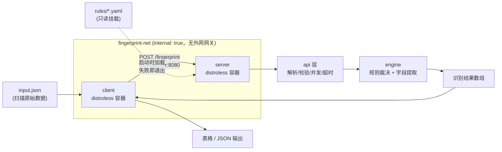

# Banner 指纹识别系统

接收一批网络扫描原始数据（`ip` / `port` / `banner`），识别出对应的**协议、软件与版本**信息。

`client + server` 架构，`docker compose up --build` 一键启动，规则与代码解耦，容器以最小权限运行。

---

## 目录

- [快速开始](#快速开始)
- [接口说明](#接口说明)
- [识别能力与输出示例](#识别能力与输出示例)
- [项目结构](#项目结构)
- [架构与数据流](#架构与数据流)
- [核心设计](#核心设计)
    - [识别引擎：规则驱动，零硬编码](#1-识别引擎规则驱动零硬编码)
    - [规则与代码解耦](#2-规则与代码解耦)
    - [置信度模型](#3-置信度模型)
    - [健壮性：认不出来是正常结果](#4-健壮性认不出来是正常结果)
- [生产级部署说明](#生产级部署说明)
- [本地开发与测试](#本地开发与测试)
- [新增指纹规则](#新增指纹规则)
- [环境变量](#环境变量)

---

## 快速开始

前置条件：Docker（含 Compose v2）。

```bash
docker compose up --build
```

启动顺序与行为：

1. `server` 先启动，加载并编译指纹规则（失败则进程直接退出，不会带病上线）；
2. `server` 的 `healthcheck` 真正请求 `GET /health`，返回 200 后标记为 healthy；
3. `client` 以 `condition: service_healthy` 为前置条件，健康后才启动；
4. `client` 读取 `/data/input.json`，批量提交给 `http://server:8080/fingerprint`，打印识别结果。

查看结果：

```bash
docker compose logs -f client
```

期望输出（节选）：

```text
[client] 输入文件 /data/input.json 解析出 13 条记录
IP         PORT  PROTOCOL  PRODUCT   VERSION           OS_HINT  CONFIDENCE
1.2.3.4    22    SSH       OpenSSH   8.9p1             Ubuntu   0.95
1.2.3.5    80    HTTP      nginx     1.24.0            -        0.90
1.2.3.6    443   HTTP      Apache    2.4.57            Ubuntu   0.90
1.2.3.7    3306  MySQL     MySQL     8.0.32            -        0.90
1.2.3.8    6379  Redis     Redis     -                 -        0.70
1.2.3.9    21    FTP       ProFTPD   1.3.7             Debian   0.90
1.2.3.10   8080  HTTP      Jetty     9.4.51.v20230217  -        0.85
1.2.3.99   9999  unknown   -         -                 -        0.00

[client] server=http://server:8080 用时=3ms 总计=13 已识别=11 未识别=2
[client] 协议分布: HTTP=3, FTP=2, MySQL=2, Redis=2, SSH=2, unknown=2
```

停止：

```bash
docker compose down
```

> **默认部署下 server 不对宿主机暴露端口**（这是刻意的，见[生产级部署说明](#生产级部署说明)）。
> 若需要从宿主机直接 `curl` 调试，叠加调试用的 Compose 文件：
>
> ```bash
> docker compose -f docker-compose.yml -f deploy/compose.debug.yml up -d --build
> curl.exe -s http://127.0.0.1:8080/health
> ```

---

## 接口说明

### `GET /health` — 健康检查

```bash
curl.exe -s http://127.0.0.1:8080/health
```

```json
{
    "status": "ok",
    "version": "1.0.0",
    "commit": "none",
    "build_time": "unknown",
    "rules": 27,
    "rule_source": "external:/app/rules",
    "uptime_seconds": 12
}
```

只有规则成功加载并全部编译通过，进程才会启动；因此该接口 200 即代表服务**真正可用**，可直接作为
compose `healthcheck` 与 `depends_on: service_healthy` 的判据。

### `POST /fingerprint` — 批量识别

**请求体**三种形态均支持（宽松解析，避免因导出格式差异导致整批失败）：

```jsonc
// ① 顶层数组（推荐）
[{"ip":"1.2.3.4","port":22,"banner":"SSH-2.0-OpenSSH_8.9p1 Ubuntu-3ubuntu0.1"}]

// ② 对象包裹（键名兼容 records / data / items / results / banners / targets）
{"records":[{"ip":"1.2.3.4","port":22,"banner":"..."}]}

// ③ 单条对象
{"ip":"1.2.3.4","port":22,"banner":"..."}
```

字段宽容度：`port` 支持数字或字符串（`22`、`"22"`、`"22/tcp"`）；
`banner` 的别名 `response` / `raw` / `data` / `service_banner` / `banner_text` 也会被识别。

**响应**：默认返回识别结果数组，与题目示例保持一致。加 `?envelope=true` 时额外返回统计信息。

```bash
curl.exe -s -X POST http://127.0.0.1:8080/fingerprint \
  -H "Content-Type: application/json" \
  -d '[{"ip":"1.2.3.4","port":22,"banner":"SSH-2.0-OpenSSH_8.9p1 Ubuntu-3ubuntu0.1"}]'
```

```json
[
    {
        "ip": "1.2.3.4",
        "port": 22,
        "protocol": "SSH",
        "product": "OpenSSH",
        "version": "8.9p1",
        "os_hint": "Ubuntu",
        "confidence": 0.95
    }
]
```

`?envelope=true` 时：

```json
{
    "results": [
        /* 同上 */
    ],
    "summary": {
        "total": 1,
        "known": 1,
        "unknown": 0,
        "by_protocol": { "SSH": 1 }
    }
}
```

**错误响应**（全部为 4xx，绝不因输入问题返回 5xx）：

| 状态码 | 场景                                    | 响应体                                                                       |
| ------ | --------------------------------------- | ---------------------------------------------------------------------------- |
| 400    | 请求体为空 / 非法 JSON / 找不到记录数组 | `{"error":"invalid_request","message":"...","hint":"..."}`                   |
| 404    | 路径不存在                              | `{"error":"not_found","message":"可用接口: GET /health, POST /fingerprint"}` |
| 405    | 方法不允许                              | `{"error":"method_not_allowed",...}`                                         |
| 413    | 请求体超过上限（默认 8 MiB）            | `{"error":"payload_too_large",...}`                                          |

响应头附带 `X-Record-Count`（本次记录数）与 `X-Rule-Count`（当前规则条数），便于观测。

---

## 识别能力与输出示例

字段 `confidence` 为 0~1 的浮点数；**认不出来的记录统一返回 `protocol: "unknown"`、`confidence: 0.00`，
其余字段为空字符串，并且绝不报错、绝不影响同批次其它记录的识别。**

| 协议      | 覆盖的产品                                                                                                            | 说明                                                                     |
| --------- | --------------------------------------------------------------------------------------------------------------------- | ------------------------------------------------------------------------ |
| **SSH**   | OpenSSH、Dropbear、libssh，泛化兜底                                                                                   | 从 `SSH-2.0-OpenSSH_8.9p1 Ubuntu-3ubuntu0.1` 提取版本与发行版            |
| **HTTP**  | nginx、OpenResty、Tengine、Apache、Apache Tomcat、Jetty、Microsoft IIS、lighttpd、Caddy、gunicorn、Werkzeug，泛化兜底 | 基于状态行 / `Server` 头 / 特征页面                                      |
| **MySQL** | MySQL、MariaDB                                                                                                        | 兼容握手包二进制形态（`\x0a8.0.32\x00...`、`5.5.5-10.11.2-MariaDB`）     |
| **Redis** | Redis（带版本 / 不带版本两档）                                                                                        | `-NOAUTH`、`+PONG`、`*N`、`$N` 等 RESP 弱特征；有 `redis_version` 时升档 |
| **FTP**   | ProFTPD、vsftpd、Pure-FTPd、FileZilla Server、wu-ftpd，泛化兜底                                                       | 基于 `220` 欢迎语                                                        |

完整的自测数据见 [`testdata/input.json`](testdata/input.json)（13 条，含 2 条故意无法识别的脏数据）。

---

## 项目结构

```text
.
├── docker-compose.yml            # 一键启动编排（服务发现、健康依赖、安全加固）
├── deploy/
│   ├── Dockerfile.server         # server 多阶段构建 → distroless
│   ├── Dockerfile.client         # client 多阶段构建 → distroless
│   └── compose.debug.yml         # 仅本地调试用：临时把 server 端口映射到 127.0.0.1
├── rules/                        # ★ 指纹规则（纯数据，与代码解耦）
│   ├── embed.go                  # go:embed 把 *.yaml 打进二进制
│   ├── ssh.yaml
│   ├── http.yaml
│   ├── mysql.yaml
│   ├── redis.yaml
│   └── ftp.yaml
├── cmd/
│   ├── server/main.go            # 服务端入口（含 healthcheck 子命令、优雅退出）
│   └── client/main.go            # 独立客户端入口
├── internal/
│   ├── api/                      # Gin 路由、中间件、请求解析（含接口层测试）
│   ├── engine/                   # 匹配引擎（含表驱动测试）
│   ├── rules/                    # 规则加载与编译（含加载测试）
│   ├── model/                    # 请求/响应数据结构
│   └── buildinfo/                # 构建期注入的版本信息
├── testdata/input.json           # 自测扫描数据
├── .dockerignore / .editorconfig / .gitignore
└── README.md
```

---

## 架构与数据流



请求处理链路：

1. **Gin 中间件**：panic 恢复 → 结构化访问日志 → 请求体大小限制 → 单请求超时上下文；
2. **协议层**：宽松解析出 `[]Record`，格式错误返回 400 并给出 `hint`；
3. **引擎层**：按 `GOMAXPROCS` 并发识别，输出顺序与输入严格一致；单条记录 panic 被 `recover` 成
   `unknown`，不影响整批；上下文取消时剩余记录快速降级为 `unknown` 而不挂起；
4. **响应**：默认返回数组；`?envelope=true` 返回带统计的信封结构。

---

## 核心设计

### 1. 识别引擎：规则驱动，零硬编码

`internal/engine` 中**没有任何一个协议名或产品名字符串**。它只做四件事：

1. 用规则的 `match` 条件筛选候选规则；
2. 用规则的 `version` / `os_hint` 正则提取字段；
3. 按 `(priority, confidence)` 裁决出唯一结果；
4. 一条都命中不了 → 返回 `unknown`。

裁决顺序为 **priority 高者胜 → confidence 高者胜 → 配置中的先后顺序**，结果完全确定、可复现。
`priority` 表达的是"特征的**具体程度**"：例如 nginx 的具体规则（100）永远压过 HTTP 泛化兜底规则（10）。

### 2. 规则与代码解耦

规则是**纯数据**，位于 `rules/*.yaml`，不参与任何 Go 逻辑：新增指纹 = 改 YAML，不需要改代码。

两种加载方式并存：

| 方式         | 触发条件                   | 特点                                                                     |
| ------------ | -------------------------- | ------------------------------------------------------------------------ |
| **内嵌**     | `RULES_DIR` 为空           | 通过 `go:embed` 打进二进制，镜像自包含，单文件即可运行                   |
| **外部目录** | `RULES_DIR` 指向存在的目录 | 覆盖内嵌规则，改 YAML + 重启进程即可生效，**无需重新编译、无需重建镜像** |

`docker-compose.yml` 默认启用第二种（`RULES_DIR=/app/rules` + `./rules:/app/rules:ro` 只读挂载），
让"规则可热调整"这件事直接可见；把这两行删掉即回退到内嵌模式。

加载期做了严格校验，**不合格的规则会让进程启动失败**，而不是留到运行期静默失效：

- 正则必须能编译（报错信息带 `rule id` 与字段名）；
- `match.any` 与 `match.all` 不能同时为空；
- `confidence` 必须在 0~1；
- `rule id` 全局唯一（跨文件查重）。

所有规则文件加载后按 `priority` 降序、`id` 升序稳定排序，保证裁决结果与文件读取顺序无关。

### 3. 置信度模型

置信度**完全来自规则配置**，引擎不做任何隐式加权 —— 想调置信度就改 YAML，行为可预测、可复现。

| 场景                                       | 置信度      | 依据                                        |
| ------------------------------------------ | ----------- | ------------------------------------------- |
| SSH / OpenSSH（含版本 + 发行版）           | 0.95        | 协议标识 + 软件名 + 版本号，强特征          |
| HTTP nginx / Apache / MySQL / FTP 具体产品 | 0.90        | `Server` 头 / 握手包 / 欢迎语带产品名与版本 |
| HTTP Jetty                                 | 0.85        | `Server: Jetty(9.4.51)`                     |
| Redis 带 `redis_version`                   | 0.92        | INFO 输出带明确版本                         |
| Redis 仅弱特征（`-NOAUTH`、`+PONG`）       | 0.70        | 只能确定协议，拿不到版本                    |
| HTTP / FTP 泛化兜底                        | 0.60 / 0.75 | 只确认协议族，产品未知                      |
| 完全认不出                                 | 0.00        | —                                           |

### 4. 健壮性：认不出来是正常结果

题目明确要求"认不出来算 unknown 不算错，但服务不能崩"，因此做了多层隔离：

| 风险                          | 处理方式                                               |
| ----------------------------- | ------------------------------------------------------ |
| 单条 banner 触发正则异常      | 每条记录独立 `recover`，异常降级为 `unknown`，整批继续 |
| 超长 banner 拖垮正则          | 截断到 64 KiB（`engine.MaxBannerBytes`），而非报错     |
| 空 banner / 空字符串 / 全空白 | 直接返回 `unknown`，不进入匹配                         |
| 请求体不是合法 JSON           | 返回 400 + 可读的 `message` 与 `hint`                  |
| 请求体过大                    | `http.MaxBytesReader` 限制 8 MiB，超限返回 413         |
| 请求处理耗时过长              | 单请求 30s 超时上下文，超时后记录快速降级为 `unknown`  |
| 处理中 panic                  | Gin recovery 中间件兜底，返回 500 且进程存活           |
| 进程收到 SIGTERM              | `srv.Shutdown` 优雅退出，在途请求处理完再停            |

---

## 生产级部署说明

### 容器间访问方式收敛

- `server` **不做任何端口映射**，只 `expose: 8080`：宿主机的其它进程无法直接连入；
- `client` 通过 **compose 服务名** `http://server:8080` 访问，走 Docker 内置 DNS 解析，不依赖宿主端口；
- 两者位于自定义网络 `fingerprint-net`，且 `internal: true` —— 该网络**没有对外网关**，
  容器可以互访但不能主动访问外网，收敛出口流量；
- 需要人工调试时才叠加 `deploy/compose.debug.yml`，且只绑 `127.0.0.1`，不暴露到局域网。

### 启动依赖：真实的健康检测

```yaml
server:
    healthcheck:
        test: ["CMD", "/server", "healthcheck"] # 真正请求 GET /health
client:
    depends_on:
        server:
            condition: service_healthy # 等"健康"，不是等"启动"
```

- `healthcheck` 不是 `sleep`，也不是"容器进程还在"：它真的发起 HTTP 请求，只有
  `/health` 返回 200 才判定健康；
- 因为运行镜像是 distroless（无 shell、无 curl/wget），**探针被做进二进制**：
  `/server healthcheck` 子命令请求本机 `/health`，用退出码表达结果；
- `start_period: 3s` + `retries: 5` 给冷启动留出余量，避免误判。

### 镜像体现的编译打包理解

- **多阶段构建**：`golang:1.26-alpine` 构建 → `gcr.io/distroless/static-debian12:nonroot` 运行，
  运行镜像里没有编译器、没有 shell、没有包管理器；
- **静态编译**：`CGO_ENABLED=0 GOOS=linux`，产物无动态库依赖，才能跑在 distroless/static 上；
- **体积与可复现**：`-trimpath` 去掉构建机路径、`-ldflags="-s -w"` 去掉符号表；
- **层缓存**：先 `COPY go.mod go.sum` 再 `go mod download`，之后才 COPY 源码 ——
  改业务代码不会触发重新下载依赖；
- **BuildKit cache mount**：`/go/pkg/mod` 与 `/root/.cache/go-build` 跨构建复用，重复构建明显加速；
- **版本注入**：`-ldflags -X ...buildinfo.Version/Commit/Date`，`/health` 可直接查到线上跑的是哪个提交；
- **`.dockerignore`** 收敛构建上下文。

### 容器运行权限收紧

| 措施                                   | 作用                                       |
| -------------------------------------- | ------------------------------------------ |
| `user: "65532:65532"`                  | 非 root 运行（distroless `nonroot`）       |
| `read_only: true`                      | 根文件系统只读，杜绝运行期写入与落盘持久化 |
| `tmpfs: /tmp`                          | 只读根下仍提供一个内存态可写目录           |
| `cap_drop: [ALL]`                      | 丢弃全部 Linux capabilities                |
| `security_opt: no-new-privileges:true` | 禁止 setuid 等提权路径                     |
| `init: true`                           | 由 tini 回收僵尸进程                       |
| `deploy.resources.limits.{cpus,memory,pids}` | CPU / 内存 / 进程数上限，防止单容器拖垮主机、抑制 fork 炸弹 |

### 识别规则与程序代码解耦

见 [核心设计 §2](#2-规则与代码解耦)：规则是 YAML 纯数据，可通过只读挂载在运行期替换，
加载期严格校验，`/health` 会回报当前生效的规则条数与来源（`builtin` 或 `external:<dir>`）。

---

## 本地开发与测试

无需 Docker 即可开发调试：

```bash
# 1) 运行全部测试
go test ./...
go vet ./...

# 2) 本地起 server（规则默认取内嵌副本；-rules rules 可改为读外部目录）
go run ./cmd/server -addr :8080 -rules rules

# 3) 另开终端跑 client
go run ./cmd/client -server http://127.0.0.1:8080 -file testdata/input.json
go run ./cmd/client -server http://127.0.0.1:8080 -file testdata/input.json -output json
```

测试覆盖：

| 测试文件                         | 覆盖内容                                                                                                                     |
| -------------------------------- | ---------------------------------------------------------------------------------------------------------------------------- |
| `internal/engine/engine_test.go` | 五类协议 + nginx/Apache/Jetty 产品分支的精确断言（含版本号与置信度）、脏数据全部降级 `unknown`、批量保序、上下文取消、空批次 |
| `internal/rules/loader_test.go`  | 内嵌规则加载、外部目录覆盖、非法规则（坏正则/缺匹配条件/置信度越界）必须在启动期报错                                         |
| `internal/api/api_test.go`       | `/health`、数组/对象两种入参、信封响应与统计、空批次返回 `[]`、五类畸形输入均返回 4xx、413 超限、404 路由兜底                |

client 支持的参数：

```text
-server   server 地址，默认取环境变量 SERVER_URL，再默认 http://127.0.0.1:8080
-file     本地扫描数据文件，默认取 INPUT_FILE，再默认 testdata/input.json
-timeout  HTTP 超时，默认 30s
-output   输出格式 table | json，默认 table
```

---

## 常见问题排查

### `docker compose build` 报 `x-docker-expose-session-sharedkey` 包含非法字符

部分 Windows + Docker Desktop 环境下，`docker compose build` 会走 Buildx bake 路径并失败：

```text
failed to dial gRPC: rpc error: code = Internal desc = header key
"x-docker-expose-session-sharedkey" contains value with non-printable ASCII characters
```

这是 Docker Desktop 的 bake 通道问题，与项目本身无关。绕开方式是按 compose 里约定的镜像名分别构建，
再以 `--no-build` 启动（二者产物完全等价）：

```bash
docker build -f deploy/Dockerfile.server -t huashun/fingerprint-server:1.0.0 .
docker build -f deploy/Dockerfile.client -t huashun/fingerprint-client:1.0.0 .
docker compose up -d --no-build
```

### 客户端一直不启动

`client` 以 `condition: service_healthy` 依赖 `server`，若 `server` 始终不健康，`client` 会一直等待。
先看健康详情与日志：

```bash
docker inspect --format '{{json .State.Health}}' huashun-fingerprint-server-1
docker compose logs server
```

`server` 健康检查失败最常见的两个原因是**端口被占用**与**规则目录挂载内容非法**
（规则写错会让进程直接退出，`docker compose logs server` 能看到带 `rule id` 的报错）。

### `curl` 连不上 server

默认部署下 `server` **不做端口映射**，这是刻意的。需要直连时叠加调试文件：

```bash
docker compose -f docker-compose.yml -f deploy/compose.debug.yml up -d --no-build
```

---

## 新增指纹规则

在 `rules/` 下新增或修改 YAML 即可，**不需要改动任何 Go 代码**：

```yaml
- id: my-service # 全局唯一，用于排障定位
  protocol: MYPROTO # 协议名，认不出来时统一为 unknown
  product: MyProduct # 产品名
  priority: 100 # 特征越具体越高；泛化兜底给 10
  confidence: 0.9 # 0~1，直接作为最终置信度
  match:
      any: # 任一命中即匹配
          - "(?im)^MYPROTO/"
      all: [] # 必须全部命中（可选）
      none: # 命中则否决本条规则（可选）
          - "(?i)not-my-service"
  version:
      - '(?i)MyProduct/([0-9][0-9A-Za-z.\-]*)' # 取第一个捕获组
  os_hint:
      - regex: '(?i)\((Ubuntu|Debian|CentOS)\)'
        value: $1 # $1 引用捕获组；也可写死字面值
```

约定：

- YAML 单引号字符串中反斜杠是字面量，正则**不需要二次转义**；
- `version` / `os_hint` 提取不到时留空即可，**不算识别失败**；
- `(?i)` 忽略大小写、`(?m)` 多行、`(?s)` 让 `.` 匹配换行 —— banner 里常有 `\r\n`，按需组合。

修改后：内嵌模式需重新构建镜像；外部挂载模式 `docker compose restart server` 即可生效。

---

## 环境变量

### server

| 变量              | 默认值                | 说明                                |
| ----------------- | --------------------- | ----------------------------------- |
| `SERVER_ADDR`     | `:8080`               | HTTP 监听地址                       |
| `RULES_DIR`       | 空                    | 外部规则目录；为空时使用内嵌规则    |
| `LOG_LEVEL`       | `info`                | `debug` / `info` / `warn` / `error` |
| `HEALTHCHECK_URL` | 由 `SERVER_ADDR` 推导 | healthcheck 子命令的探测地址        |

对应命令行参数：`-addr`、`-rules`、`-log-level`、`-max-body-bytes`、`-request-timeout`。

### client

| 变量         | 默认值                  | 说明                                         |
| ------------ | ----------------------- | -------------------------------------------- |
| `SERVER_URL` | `http://127.0.0.1:8080` | server 地址（容器内为 `http://server:8080`） |
| `INPUT_FILE` | `testdata/input.json`   | 待识别的扫描数据文件                         |

---

## 附：整体设计取舍

- **静态解析而非主动探测**：题目输入已经给出了 `banner`（扫描阶段抓取的原始响应），
  系统只做识别、不发起网络连接 —— 无额外网络依赖、无连接超时不确定性，结果稳定可复现。
- **默认响应为裸数组**：与题目给出的示例响应结构一致，便于直接比对；
  需要统计信息时用 `?envelope=true`，不破坏默认契约。
- **入参宽松、出参严格**：入参兼容多种键名与类型以避免整批失败；出参字段恒定、类型恒定，
  `unknown` 也走同一条结构，客户端无需分支处理。
